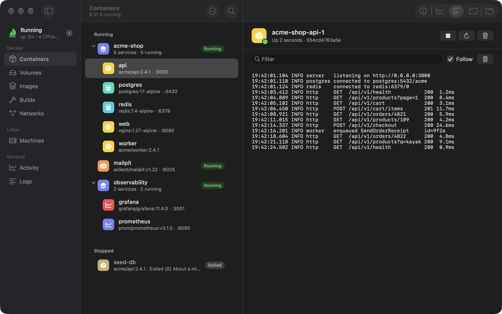
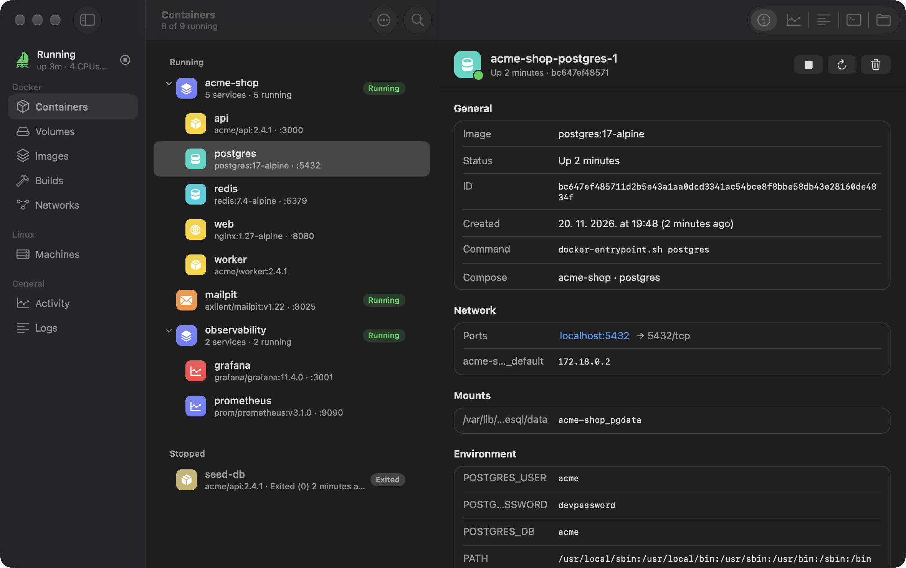
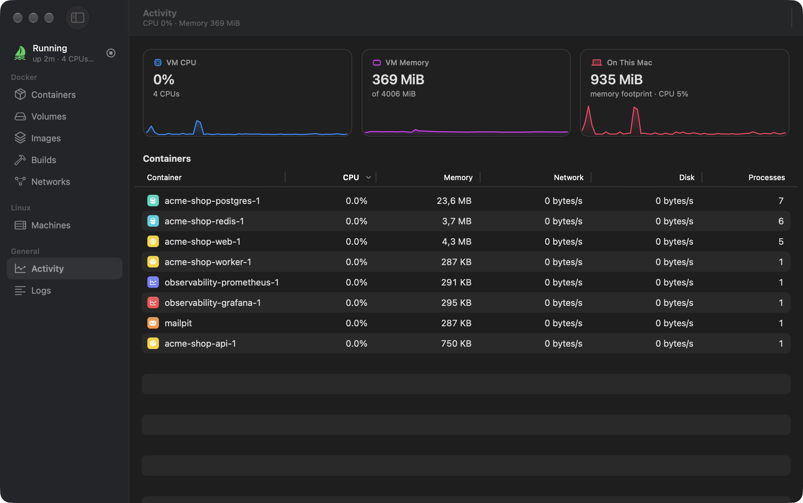
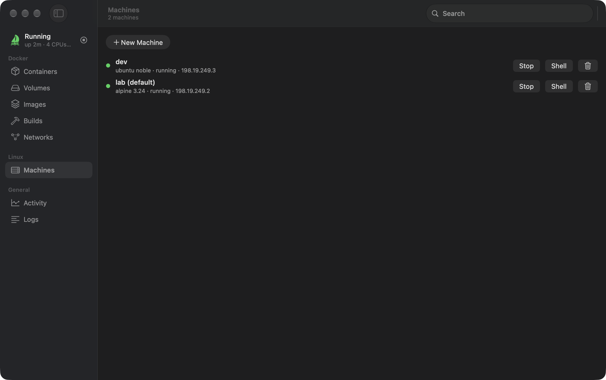

# katamaran

katamaran runs Docker containers and Linux machines on Apple silicon Macs inside one lightweight Linux virtual machine. It includes a native macOS app built with Swift and AppKit, a command-line tool (`katamaran`, symlinked as `kat`), and an optional single-node Kubernetes (`k3s`) cluster that stays off by default with zero overhead.

katamaran is free software licensed under the GNU Affero General Public License, version 3 or later (AGPL-3.0).



## Why katamaran exists

Most Docker runtimes on macOS pair QEMU or Apple Virtualization.framework with a general file-sharing server such as virtiofs, sshfs, or 9p. That architecture stalls on real development projects that store tens of thousands of small files on a bind mount, such as a PHP `vendor/` directory or a JavaScript `node_modules/` tree.

Today, OrbStack is the only fast Docker runtime on macOS for those workloads. We benchmark katamaran against OrbStack for that reason. katamaran matches or beats OrbStack across everyday development tasks while staying open source under AGPL-3.0.

## What katamaran does differently

katamaran removes process hops, socket copies, and worker wakeups across four parts of the stack.

### Direct virtio-fs hypercalls and APFS backend

Standard virtio-fs queues every FUSE operation to a virtqueue, wakes a host worker thread, and injects a completion interrupt into the guest. katamaran runs a custom virtual machine monitor (`katamaran-vm`, based on libkrun and Hypervisor.framework) that handles small, bounded foreground FUSE requests inline on the vCPU through an ARM SMCCC vendor call (`KAT_FS_DIRECT`). Requests that can block, such as iCloud dataless files or network volumes, still route to an asynchronous worker pool.

The macOS backend is written for APFS. Directory listings use `getattrlistbulk(2)`, and plain `FUSE_READDIR` requests only inline directory records (`ATTR_CMN_NAME`, `ATTR_CMN_OBJTYPE`, and `ATTR_CMN_FILEID`) without reading child inodes. Busy parent directories hold pinned `O_EVTONLY` file descriptors so lookups, opens, and unlinks run `*at()` calls instead of volfs path resolution, and `unlink` skips `fstatat` when no open handle matches.

Guest metadata, file pages, and unchanged directory listings stay cached for up to 3,600 seconds. A single macOS FSEvents stream watches shared folders, sends targeted FUSE node ID invalidations over virtio-vsock, and emits Linux inotify events inside containers. Shared files appear owned by the calling container user (`owner_caller`) so non-root containers write to bind mounts without disabling attribute caching.

### In-process networking and macOS DNS

`katamaran-vm` loads a patched `gvproxy` (`libgvproxy.dylib`) directly inside the VM process. Small outbound guest frames transmit inline on the vCPU thread, small inbound frames copy through a stack buffer without heap allocations or cgo pinning, and bulk transfers move across a 65,520-byte MTU with 8 MiB macOS socket buffers and copy buffers that grow to 1 MiB.

DNS queries resolve through the macOS system resolver (`dns_sd`) with answer caching and request coalescing, so VPN split-DNS and macOS `/etc/hosts` entries work inside containers. Both published ports (`-p`) and unpublished container ports forward to `127.0.0.1` on macOS. Inside the Linux guest, Layer 2 Docker bridge traffic skips IP netfilter hooks, and the arm64 vDSO ships both GNU and SysV hash tables so musl and glibc containers resolve `clock_gettime` in userspace.

### Active 64 KiB memory reclaim and adaptive idle polling

Guest RAM maps in separate 64 KiB XNU VM entries so freed 64 KiB blocks reported by virtio-balloon are replaced with fresh anonymous mappings and removed from macOS's physical footprint immediately. Inside Linux, `kat-init` enables an LZ4-compressed `zram` swap device sized to guest RAM to absorb memory spikes without disk I/O or OOM thrashing, trims idle file and reclaimable slab caches through cgroup v2 `memory.reclaim`, and compacts fragmented memory after workloads finish.

Waking a halted vCPU from WFI on Hypervisor.framework costs tens of microseconds. The guest kernel defines `TIF_POLLING_NRFLAG` on arm64 and polls adaptively before halting, keeping request-response traffic between containers fast while dropping back to zero polling when idle.

### Built-in Linux machines, Finder access, and Rosetta TSO

katamaran runs full LXC Linux distributions (`ubuntu`, `debian`, `alpine`, `fedora`, `arch`, and others) inside the same VM with `kat shell` and an integrated SSH proxy (`ssh dev@katamaran`). An in-guest NFSv3 server (`kat-nfs`) mounts Docker volumes, running containers, and machine files at `~/Katamaran` in Finder.

For `linux/amd64` images, katamaran shares Apple Rosetta for Linux read-only into the guest and toggles hardware total store ordering (`ACTLR_EL1.EnTSO`) per task on context switch so native arm64 code pays no TSO overhead. QEMU user-mode emulation is bundled as a fallback.

## Screenshots

| Container inspection | VM and container activity |
|---|---|
|  |  |



## Benchmarks

We compare katamaran against OrbStack 2.2.5 because OrbStack is the only fast Docker runtime available on macOS today. The benchmark suite is tailored to real-life development usage rather than synthetic microbenchmarks. It runs a full Laravel 12 and Vite application on a bind mount against PostgreSQL 17 and Redis 7, real package installs (`npm ci`, `pnpm install`, `composer install`, `bun install`), a Rust debug build of ripgrep, `git status` and `rm -rf` on the Linux 6.18 source tree, `find` over `node_modules`, parallel Composer cache extractions, live HTTP and DNS calls to macOS, Finder NFS operations, Rosetta x86-64 builds, and VM lifecycle and memory reclaim cycles.

All numbers below come from run `20261120c` on a Mac15,10 with an Apple M3 Max (14 cores, 36 GiB RAM, macOS 27.2.1). Both runtimes ran side by side with 14 vCPUs and 16 GiB of memory, alternating run by run. Every value is the median of 5 timed runs (10 runs for `docker run --rm alpine true`). Full results live in `bench/results/2026-11-20-katamaran-vs-orbstack-20261120c.md`.

### Where katamaran is faster

| Task | OrbStack | katamaran | Faster |
|---|---:|---:|---:|
| Stop the VM | 1.95 s | 0.12 s | 16.3x |
| DNS lookups of 8 different hosts | 8.57 ms | 0.56 ms | 15.3x |
| DNS lookup in a container (cached name) | 0.92 ms | 0.09 ms | 10.0x |
| Host write to container inotify event | 75.0 ms | 13.6 ms | 5.5x |
| Laravel `db:seed` (12,000 inserts and 3,000 row-lock transactions) | 27.5 s | 7.59 s | 3.6x |
| `git status` in a fresh container right after cold pass | 507 ms | 176 ms | 2.9x |
| `git status` on the Linux tree (warm bind mount) | 0.41 s | 0.17 s | 2.5x |
| Footprint 10 s after a 4 GiB container exits | 5,632 MiB | 2,769 MiB | 2.0x lower |
| `find` over `node_modules` (33,598 files on a bind mount) | 0.22 s | 0.11 s | 2.0x |
| Cold start to the first `docker run` | 1.43 s | 0.97 s | 1.5x |
| Idle CPU, no containers | 1.57 % | 1.13 % | 1.4x lower |
| `stat()` on a 91,000-file bind mount (warm) | 451 ns | 346 ns | 1.3x |
| Read 10,000 small Linux files from `~/Katamaran` | 4.56 s | 3.55 s | 1.3x |
| Fresh idle memory footprint (no containers) | 1,126 MiB | 922 MiB | 1.2x lower |
| `npm ci` on a bind mount (warm cache) | 3.79 s | 3.23 s | 1.2x |
| Container upload to macOS (1 GiB) | 4,920 MiB/s | 5,698 MiB/s | 1.2x |
| HTTP to macOS, new connection p50 | 377 µs | 334 µs | 1.1x |
| 10 parallel unzips of a Composer cache on a bind mount | 1.09 s | 0.98 s | 1.1x |
| Copy a 21,000-file tree from Linux to macOS | 14.3 s | 12.8 s | 1.1x |
| Container download from macOS (1 GiB) | 4,101 MiB/s | 4,440 MiB/s | 1.1x |
| Laravel `GET /login` request with opcache on | 27.8 ms | 26.3 ms | 1.1x |

### Where katamaran is about the same

| Task | OrbStack | katamaran | Ratio |
|---|---:|---:|---:|
| `composer install` on a bind mount (warm cache) | 3.68 s | 3.54 s | 1.04x |
| `pnpm install` on a bind mount (warm store) | 2.43 s | 2.32 s | 1.05x |
| `vite build` on a bind mount | 6.29 s | 6.26 s | 1.01x |
| `cargo build` (ripgrep debug build on a bind mount) | 3.49 s | 3.51 s | 1.00x |
| Laravel `GET /login` request with opcache off | 157 ms | 155 ms | 1.01x |
| Container to container Redis PING round trip | 6.05 µs | 6.15 µs | 0.98x |
| `bun install` on a bind mount (warm cache) | 3.72 s | 3.95 s | 0.94x |
| `artisan migrate:fresh` (Postgres 17) | 0.73 s | 0.77 s | 0.94x |
| Sequential read, 1 MiB blocks, bind mount | 4,029 MB/s | 4,092 MB/s | 1.02x |
| Random read, 4 KiB blocks, bind mount | 1,088 MB/s | 1,098 MB/s | 1.01x |
| Random write, 4 KiB blocks, bind mount | 775 MB/s | 747 MB/s | 0.96x |
| Download from a published port (1 GiB) | 5,096 MiB/s | 5,131 MiB/s | 1.01x |
| amd64 `gcc -O2` under Rosetta | 20.3 s | 20.2 s | 1.01x |
| Peak memory footprint with a 4 GiB container | 5,632 MiB | 5,636 MiB | 1.00x |

OrbStack remains slightly ahead on `rm -rf` of the 91,000-file Linux tree (5.12 s vs 5.71 s), HTTP keep-alive p50 latency to macOS (87.6 µs vs 95.6 µs, while p99 is tied at 149 µs vs 151 µs), and post-workload idle footprint after a full suite (1,331 MiB vs 1,540 MiB).

To reproduce the benchmarks on your own Mac, use the tool in `bench/`.

## Requirements

- An Apple silicon Mac (M1 or later)
- macOS 15 or later
- The Docker command-line tools (`docker`, `docker-buildx`, and `docker-compose`):

```sh
brew install docker docker-buildx docker-compose
```

- Apple Rosetta (optional, for fast `linux/amd64` images):

```sh
softwareupdate --install-rosetta
```

## Install

Install with Homebrew:

```sh
brew install --cask nklmilojevic/katamaran/katamaran
```

Or install from the signed release disk image:

1. Download and open the latest [Katamaran.dmg](https://github.com/nklmilojevic/katamaran/releases/latest/download/Katamaran.dmg) (or browse all versions on [GitHub releases](https://github.com/nklmilojevic/katamaran/releases/latest)).
2. Drag `Katamaran.app` into `/Applications`.
3. Open **Katamaran**.

On first launch (and after upgrades), **Katamaran** runs `kat setup --default` automatically. Setup installs:

- A LaunchAgent that starts the daemon and VM when you log in
- A Docker context named `katamaran` (set as the default Docker context whenever Katamaran launches)
- A symlink at `~/.local/bin/kat` pointing to the `katamaran` binary

Add `~/.local/bin` to your `PATH` to run `kat` from any terminal. To remove the LaunchAgent, Docker context, and symlink while keeping your data under `~/.katamaran`, run `kat uninstall`.

## Quick start

`kat` and `katamaran` are the same binary.

### Control the VM

```sh
kat start
kat status
kat stop
kat restart
```

### Run Docker containers

Launching **Katamaran** or running `kat start` sets `katamaran` as the default Docker context automatically:

```sh
docker run --rm hello-world
```

If you switched to another Docker context, switch back with `docker context use katamaran`. For tools that read `DOCKER_HOST` instead of Docker contexts, export the socket path:

```sh
export DOCKER_HOST="unix://$HOME/.katamaran/run/docker.sock"
```

Containers reach services on macOS through `host.docker.internal`. Published ports (`-p`) and unpublished container ports are reachable on `127.0.0.1` on macOS.

### Configure resources and behavior

Open **Settings** in the app or use `kat config`:

```sh
kat config get
kat config set cpus=8 memory=12G pause_on_sleep=on
kat restart
```

Settings live in `~/.katamaran/config.toml` and take effect at the next VM start, except `launch_at_login` and `kubernetes` (which apply immediately) and `k8s_version`, `k8s_disable`, and `k8s_args` (which apply at the next Kubernetes start without a VM restart; `k8s_disable`, `k8s_args`, and `k3s-config.yaml` need a VM running a current guest image).

| Key | Default | Description |
|---|---|---|
| `cpus` | All host cores | Number of vCPUs assigned to the VM |
| `memory_mib` | Half of host RAM, clamped to 2 GiB to 16 GiB | Upper memory ceiling (`memory=8G` is accepted by `config set`) |
| `amd64` | `auto` | How `linux/amd64` containers run (`auto`, `rosetta`, `qemu`, or `off`) |
| `auto_forward` | `true` | Forward unpublished container TCP ports to the configured `forward_addresses` |
| `forward_addresses` | `["127.0.0.1"]` | macOS loopback addresses for forwarded TCP ports; for example, `kat config set forward_addresses=127.0.0.1,172.16.1.200` if the alias is assigned to `lo0` |
| `mount` | `true` | Mount Linux files on macOS over NFS |
| `mount_path` | `~/Katamaran` | Absolute path for the macOS NFS mount |
| `launch_at_login` | `true` | Start the daemon and VM when you log in |
| `pause_on_sleep` | `false` | Freeze vCPUs while the Mac sleeps |
| `kubernetes` | `false` | Enable the optional single-node Kubernetes (`k3s`) cluster |
| `k8s_version` | Pinned build | k3s release to run, e.g. `v1.32.5+k3s1` (applies at the next Kubernetes start) |
| `k8s_disable` | `[]` | Bundled `k3s` components to disable, e.g. `k8s_disable=traefik` (applies at the next Kubernetes start) |
| `k8s_args` | `[]` | Extra arguments appended to `k3s server`, limited to settings that cannot conflict with how katamaran runs the cluster (see the Kubernetes docs; applies at the next Kubernetes start; or place a `k3s` config at `~/.katamaran/k3s-config.yaml`) |
| `nofile` | `1048576` | Open-files limit (`ulimit -n`) set at guest boot; containerd, dockerd, and workloads inherit it unless they set their own |

### Browse Linux files in Finder

When `mount` is enabled, katamaran mounts Linux files at `~/Katamaran`:

- `docker/volumes/<name>` holds the files of each named Docker volume.
- `docker/containers/<name>` holds the root filesystem of each running container.
- `machines/<name>` holds the root filesystem of each Linux machine.

### Run Linux machines

Create and use full Linux distributions running as LXC machines inside the VM. Each machine creates a user matching your macOS username.

```sh
kat machine create dev
kat machine create box --distro alpine
kat machine list
kat shell dev
kat shell dev -- uname -a
kat machine stop dev
kat machine delete dev
```

Pass `ubuntu`, `debian`, `alpine`, `fedora`, `arch`, or any distribution from `images.linuxcontainers.org` to `--distro`.

To connect over SSH:

1. Run `kat setup`.
2. Add the `Include` line printed by setup to the top of `~/.ssh/config`.
3. Run `ssh dev@katamaran` or `kat ssh dev`.

### Run Kubernetes (optional)

Start an optional single-node Kubernetes (`k3s`) cluster inside the same VM. On first start, katamaran downloads the pinned `k3s` binary, merges the `katamaran` context into `~/.kube/config`, and starts the cluster sharing Docker's `containerd`. When stopped, Kubernetes uses zero resources.

```sh
kat k8s start
kat k8s status
kat k8s sync-images
kat k8s kubeconfig
kat k8s dns install
kat k8s forward 10.43.0.1:443 --local 8443
kat k8s stop
kat k8s reset
kat k8s reset --images
```

### Inspect logs and shell into the VM

```sh
kat logs
kat logs -f
kat logs --console
kat logs --source vm
kat logs --source gvproxy
kat vm shell
kat vm exec -- sysctl fs.nr_open
```

`kat vm shell` and `kat vm exec` run as `root` directly in the Linux VM's own namespaces (not an LXC machine), which is useful for inspecting `containerd`, `dockerd`, `k3s`, sysctls, rlimits, and `/var/log/*`.

### Coding-agent skill

Install the [katamaran skill](skills/katamaran/SKILL.md) for Claude Code (`~/.claude/skills`) and Codex, OpenCode, and Pi (`~/.agents/skills`):

```sh
kat skill setup
kat skill show
kat skill status
kat skill remove
```

## Documentation

Full guides, CLI and configuration references, architecture notes, and benchmark tables live in `docs/` as an Astro and Starlight site.

Preview the docs locally:

```sh
cd docs
bun install
bun run dev
```

## Build from source

Building from source requires:

- Rust with `rustup` (`rust-toolchain.toml` pins the toolchain and the `aarch64-unknown-linux-musl` target)
- Go (builds `gvproxy` and `libgvproxy.dylib`)
- Xcode command-line tools
- A running Docker engine (builds the Linux kernel, rootfs, and data disk inside containers)

Run the build tasks in order:

1. Build `katamaran`, `katamaran-vm`, `kat-init`, and `gvproxy`:

```sh
cargo xtask build
```

2. Build the guest kernel, EROFS system image, and btrfs data disk template:

```sh
cargo xtask kernel
cargo xtask rootfs
cargo xtask disk
```

Set `KATAMARAN_BUILD_CONTEXT` to use a Docker context other than the active one:

```sh
KATAMARAN_BUILD_CONTEXT=desktop-linux cargo xtask kernel
```

3. Build `target/Katamaran.app` and `target/dist/Katamaran-<version>.dmg`:

```sh
cargo xtask app
cargo xtask dmg
```

Local builds created with `cargo xtask app` and `cargo xtask dmg` are ad-hoc signed. Use `cargo xtask fmt` to format the workspace crates without touching `vendor/libkrun`.

## Project layout

| Path | Contents |
|---|---|
| `crates/kat-daemon` | `katamaran` CLI and background daemon for VM lifecycle, networking, NFS, and machines |
| `crates/kat-vmm` | `katamaran-vm` process wrapping libkrun, in-process gvproxy, and FSEvents cache invalidation |
| `crates/kat-init` | Linux guest PID 1 supervising containerd, dockerd, NFS, LXC machines, and memory reclaim |
| `crates/kat-nfs` | In-guest NFSv3 server exporting container, volume, and machine files to macOS |
| `crates/kat-proto` | Wire protocol shared between macOS and the guest |
| `crates/kat-term` | Terminal library wrapping `libghostty-vt` for container shells in the app |
| `app` | Native macOS menu-bar and management app (Swift and AppKit) |
| `xtask` | Workspace build commands (`cargo xtask ...`) |
| `guest` | Reproducible build scripts, kernel config, and kernel patches |
| `vendor/libkrun` | Patched libkrun tree (patch series in `vendor/patches`) |
| `vendor/patches/gvproxy` | Patch series applied to `gvisor-tap-vsock` during `cargo xtask gvproxy` |
| `docs` | Astro and Starlight documentation website |
| `bench` | Benchmark tool and saved comparison results |
| `scripts` | Standalone filesystem and network probe scripts |

## License

Copyright 2026 Nikola Milojević.

katamaran is free software licensed under the [GNU Affero General Public License, version 3 or later](LICENSE). You can use, modify, and redistribute it for personal or commercial work under the terms of that license.

The name "katamaran" and the katamaran icon are excluded from the AGPL license. See [TRADEMARKS.md](TRADEMARKS.md). Third-party components and their licenses are listed in [THIRD_PARTY_NOTICES.md](THIRD_PARTY_NOTICES.md).
