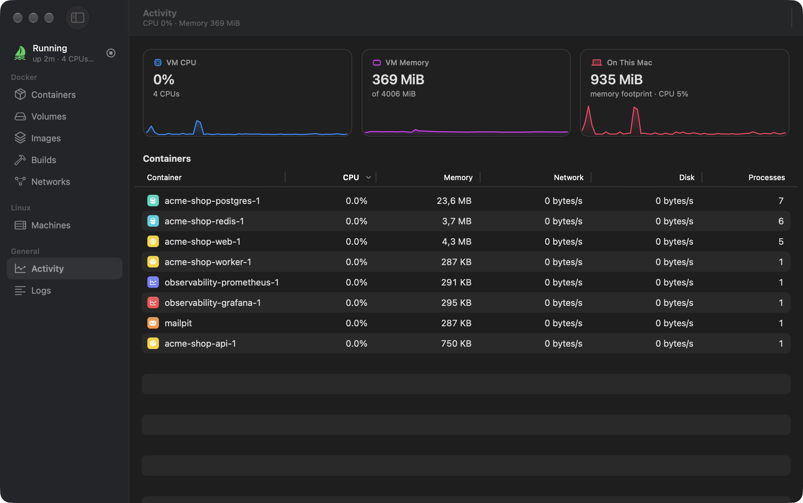

`Katamaran.app` is a native Swift and AppKit application that lives in the macOS menu bar and opens a full management window on demand. It communicates with `katamaran daemon` and the guest Docker socket directly over Unix sockets.

## Menu bar controls

Click the sailboat icon in the macOS menu bar to:

- Check whether the VM and Docker are running, starting, or stopped
- Start, stop, or restart the VM
- Open the main management window
- Open the **Settings** window
- Quit the app

Closing the main window keeps the menu-bar app and the VM running.

## Main window sections

The main window sidebar groups management views into four sections.

### Docker

- **Containers**: List running and stopped containers, start, stop, restart, remove, inspect environment and mounts, stream logs, and open an interactive terminal powered by `libghostty-vt` (`crates/kat-term`).
- **Volumes**: Inspect Docker volumes, open volume data in Finder under `~/Katamaran/docker/volumes/`, and remove unused volumes.
- **Images**: Browse local images in the containerd store, view sizes and tags, and prune unused images.
- **Builds**: Monitor active and recent Docker BuildKit builds with step progress.
- **Networks**: Inspect Docker bridge networks and attached containers.

### Kubernetes

- **Pods**: List pods grouped by namespace, with status, readiness, restarts, and age. Inspect a pod's containers, node, IP, owner, and labels, follow its logs (pick a container in multi-container pods), and delete it.
- **Services**: List services with their type and ports. Inspect cluster IP, ports, selector, and the pods it selects, open LoadBalancer and NodePort services at their forwarded address (`http://localhost:<port>`, or an active bound `forward_addresses` alias when `127.0.0.1` is not bound), and delete them.

System namespaces (`kube-system`, `kube-public`, `kube-node-lease`) are hidden by default; turn on **Show System Namespaces** in the toolbar's **More** menu. While Kubernetes is off, both views offer a **Turn On** button. The app talks to the cluster through `~/.katamaran/run/k8s-proxy.sock` by default (or `$KATAMARAN_HOME/run/k8s-proxy.sock` when `KATAMARAN_HOME` is set), relayed to an authenticated `kubectl proxy` in the VM, so it doesn't need `kubectl` on the Mac.

### Linux

- **Machines**: Create, start, stop, delete, and open interactive terminals into LXC Linux machines.

### General

- **Activity**: View live CPU and memory usage of the VM.
- **Logs**: Stream live logs from the daemon, guest console, VM monitor, and gvproxy.

## Settings window

Open **Settings** from the menu bar or press `Cmd+,`. Settings are organized into three toolbar panes:

- **General**: Toggle **Start Katamaran at login** (`launch_at_login`) and **Show VM files in Finder** (`mount`).
- **Resources**: Adjust **CPUs** (`cpus`) and **Memory** (`memory_mib`).
- **Kubernetes**: Toggle **Enable Kubernetes** (`kubernetes`), inspect live **Cluster status** (state, k3s version, API address, and kubeconfig context), and run **Sync Images** (mirrors locally built Docker images into Kubernetes) or **Reset Cluster** (stops Kubernetes and wipes all cluster state, workloads, and persistent volumes after confirmation).

Additional settings (`amd64`, `auto_forward`, `forward_addresses`, `mount_path`, `nofile`, and `pause_on_sleep`) can be changed with `kat config set` or in `~/.katamaran/config.toml`. Changes write atomically to `~/.katamaran/config.toml` and display a notice with a **Restart** button when a VM restart is required. Port links for containers and Kubernetes services prefer `localhost` when `127.0.0.1` is bound, and otherwise use the port's active bound `forward_addresses` alias.
