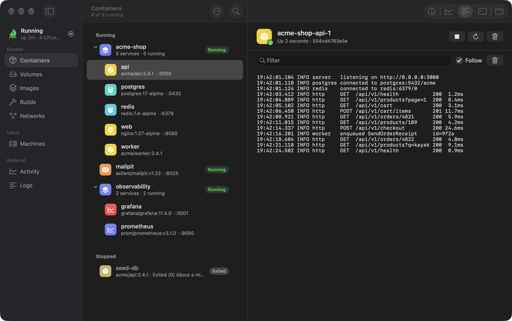

import { CardGrid, LinkCard } from '@astrojs/starlight/components';

katamaran pairs a custom Hypervisor.framework virtual machine monitor (based on libkrun) with a native Swift and AppKit macOS app and the `kat` command-line tool. Shared folders run through a macOS virtio-fs server with direct hypercalls and FSEvents cache invalidation. Networking runs in-process with gvproxy, and unused guest memory returns to macOS in 64 KiB blocks.

<CardGrid>
  <LinkCard title="Install katamaran" href="/install/" description="Check system requirements, install the macOS app, and run first-time setup." />
  <LinkCard title="Quickstart tutorial" href="/quickstart/" description="Start the VM, run a container with a bind mount, and open a Linux machine shell." />
  <LinkCard title="File sharing" href="/file-sharing/" description="Use fast bind mounts, host inotify events, and Linux files in Finder." />
  <LinkCard title="Networking" href="/networking/" description="Reach containers on localhost, reach macOS through host.docker.internal, and resolve DNS." />
  <LinkCard title="Linux machines" href="/machines/" description="Create LXC machines and connect with kat shell or SSH." />
  <LinkCard title="Command-line reference" href="/cli/" description="Look up every katamaran subcommand, argument, and flag." />
  <LinkCard title="Configuration reference" href="/configuration/" description="Tune CPU count, memory limit, Rosetta, NFS mounts, and sleep behavior." />
  <LinkCard title="Architecture" href="/architecture/" description="Read how libkrun, direct FUSE hypercalls, in-process gvproxy, and memory reclaim work." />
</CardGrid>

katamaran requires an Apple silicon Mac (M1 or later) running macOS 15 or later. An optional single-node Kubernetes (`k3s`) cluster is available via `kat k8s` and uses zero resources when off.
